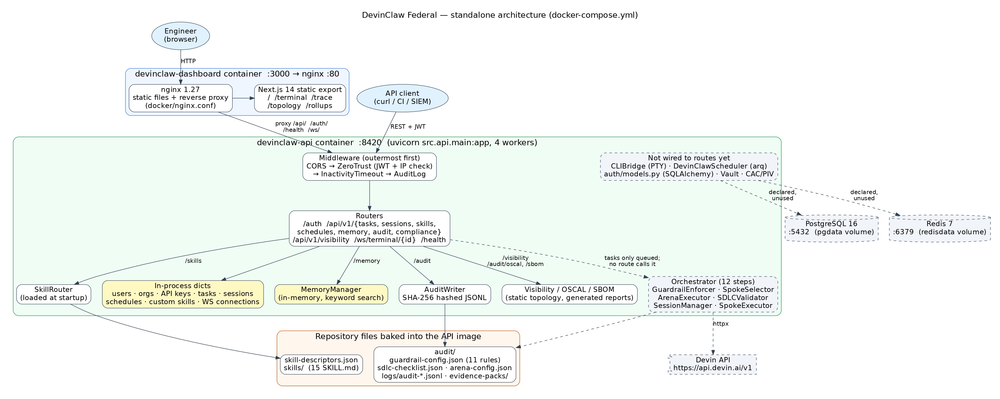

# DevinClaw Federal Architecture

This document describes the architecture as implemented in this repository: a standalone FastAPI backend (`src/`), a Next.js dashboard (`dashboard/`), and a Docker Compose deployment (`docker-compose.yml`, `docker/`). The earlier OpenClaw-dependent design (OpenClaw orchestrator, DeepWiki knowledge layer, Devin spokes) was replaced by this standalone platform on 2026-03-11.

Diagram source: [`diagrams/architecture.dot`](diagrams/architecture.dot) (Graphviz, editable) · renders: [PNG](diagrams/architecture.png) · [SVG](diagrams/architecture.svg).
Solid edges are paths the running API uses today. Dashed edges and boxes are code or infrastructure that exists but is not yet called from any request path.

To re-render after editing the DOT file, run `docs/diagrams/render.sh` (needs Graphviz `dot`).

---

## Deployment Topology

`docker-compose.yml` defines four services on the `devinclaw-net` bridge network:

| Service | Image / build | Host port | Role |
|---------|---------------|-----------|------|
| `devinclaw-dashboard` | `docker/Dockerfile.dashboard` (Node 20 build → `nginx:1.27-alpine`) | 3000 → 80 | Serves the static Next.js export and reverse-proxies `/api/`, `/auth/`, `/health`, `/ws/` to the API |
| `devinclaw-api` | `docker/Dockerfile.api` (`python:3.12-slim`) | 8420 | FastAPI app, `uvicorn src.api.main:app --workers 4` |
| `postgres` | `postgres:16-alpine`, `pgdata` volume | 5432 | Declared and health-checked; not used by application code yet |
| `redis` | `redis:7-alpine`, `redisdata` volume | 6379 | Declared and health-checked; not used by application code yet |

The API image also contains `skills/`, `audit/` and `knowledge/`, which the API reads at runtime. In local development (`make dev`), the API runs on `:8420` and `next dev` serves the dashboard on `:3000`.

## API Process (`src/api/main.py`)

### Startup

The lifespan hook configures logging and builds a `SkillRouter` (`src/core/skill_router.py`) from `audit/skill-descriptors.json`. Nothing else is initialised at startup: there is no database engine, Redis connection, scheduler worker or CLI bridge.

### Request Path

Middleware is added in this order, so a request passes through it outermost first:

1. **CORS** — origins from `settings.cors_origins`.
2. **ZeroTrustMiddleware** (`middleware/zero_trust.py`) — on every route except `/health`, `/docs`, `/redoc`, `/openapi.json`, `/auth/register` and `/auth/login`, verifies a `Authorization: Bearer` JWT if present (including its IP binding) and attaches the claims to `request.state`; a missing or invalid token is passed through, and the 401 comes from the route's `get_current_user` call. `/ws/` paths skip this middleware and authenticate in `routes/ws.py` (a `token` query parameter or the first message). Adds HSTS, frame, content-type and no-cache headers.
3. **InactivityTimeoutMiddleware** (`middleware/inactivity_timeout.py`) — rejects a token idle longer than `session_inactivity_timeout_minutes` (in-process `dict`, per worker).
4. **AuditLogMiddleware** (`middleware/audit_log.py`) — structured request log with correlation ID, user, IP, method, path, status and duration.

Route handlers then call `middleware/rbac.py` helpers (`get_current_user`, `require_role`, `get_org_id`) for role checks (admin / engineer / viewer) and tenant scoping.

### Routers

| Prefix | Module | Backing implementation |
|--------|--------|------------------------|
| `/auth` | `routes/auth.py` | In-process dicts for users, orgs, API keys and JWT sessions; `src/auth/jwt.py`, `src/auth/passwords.py` |
| `/api/v1/tasks` | `routes/tasks.py` | In-process dict; tasks are stored as `queued` and are not executed |
| `/api/v1/sessions` | `routes/sessions.py` | In-process dict |
| `/api/v1/skills` | `routes/skills.py` | `SkillRouter` (15 bundled skills) + in-process dict for custom skills |
| `/api/v1/schedules` | `routes/schedule.py` | In-process dicts for schedules and runs |
| `/api/v1/memory` | `routes/memory.py` | `MemoryManager` (in-memory list, keyword-overlap search) |
| `/api/v1/audit` | `routes/audit.py` | `AuditWriter` over `audit/` files; SBOM (`core/sbom_generator.py`) and OSCAL (`core/oscal_exporter.py`) generators |
| `/api/v1/compliance` | `routes/compliance.py` | Compliance summaries built from bundled config |
| `/api/v1/visibility` | `routes/visibility.py` | `core/visibility.py`: static service topology, traces, rollups, role dashboards |
| `/ws/terminal/{session_id}` | `routes/ws.py` | Authenticated WebSocket connection registry; input is acknowledged, not forwarded to a PTY |
| `/health` | `main.py` | Liveness JSON |

Because state lives in Python dicts inside each worker process, data does not survive a restart and is not shared between the four Uvicorn workers in the container.

## Orchestration Engine (`src/core/`)

`Orchestrator.execute_task()` (`core/orchestrator.py`) implements the 12-step lifecycle:

1. Receive task → 2. Authenticate/authorize → 3. Route to skill (`skill_router.py`) → 4. Check guardrails (`guardrail_enforcer.py`, rules from `audit/guardrail-config.json`) → 5. Select spoke (`spoke_selector.py`) → 6. Determine arena mode (`arena_executor.py`, `audit/arena-config.json`) → 7. Launch session(s) (`session_manager.py` over `spoke_executor.py`) → 8. Monitor and collect artifacts → 9. Validate SDLC gates (`sdlc_validator.py`, `audit/sdlc-checklist.json`) → 10. Write audit trail (`audit_writer.py`) → 11. Update memory (`memory/memory_manager.py`) → 12. Notify.

Arena sessions are launched and polled concurrently with `asyncio.gather`, and divergence above `divergence_threshold` (0.35) escalates. `SessionManager` calls the Devin API (`devin_api_base_url`, default `https://api.devin.ai/v1`) with `httpx` and keeps its session registry in memory.

**Current wiring:** no API route instantiates `Orchestrator`. `POST /api/v1/tasks` records the task as `queued` only, so the engine above runs only when called directly from Python.

## Persistence and State

| Data | Where it lives today |
|------|----------------------|
| Users, orgs, API keys, JWT sessions | In-process dicts in `routes/auth.py` |
| Tasks, sessions, schedules, custom skills | In-process dicts in their route modules |
| Memory entries | `MemoryManager._entries` (list) |
| Audit entries | `audit/logs/audit-YYYY-MM-DD.jsonl`, one SHA-256-hashed JSON line per event (`AuditWriter`) |
| Evidence packs | JSON files under `audit/evidence-packs/` written by `AuditWriter.write_evidence_pack` |
| Skill descriptors | `audit/skill-descriptors.json` (read at startup); skill content in `skills/*/SKILL.md` |

`src/auth/models.py` defines SQLAlchemy models (User, Organization, APIKey, Session) and `pyproject.toml` lists SQLAlchemy, Alembic, asyncpg, redis and arq, but no module creates an engine or a Redis client yet.

## Supporting Modules Not Yet on a Request Path

| Module | Purpose |
|--------|---------|
| `src/cli/bridge.py`, `src/cli/stream.py` | PTY subprocess management for the Devin CLI (spawn, input, output, restart up to 3 retries) and PTY → WebSocket streaming |
| `src/scheduler/scheduler.py`, `src/scheduler/jobs.py` | Scheduler with cron and webhook-trigger fields, in-memory job registry; built-in jobs: nightly STIG scan, weekly compliance report, daily guardrail audit, session health check |
| `src/auth/vault.py` | Secrets interface: environment-variable backend and a HashiCorp Vault stub |
| `src/auth/cac_piv.py` | CAC/PIV certificate field validation for client certs forwarded by the proxy |

## Dashboard (`dashboard/`)

Next.js 14 App Router built with `output: "export"` into static HTML, so it has no Node server in production. Pages under `src/app/`:

| Route | Page |
|-------|------|
| `/` | Operations dashboard |
| `/terminal` | Embedded terminal, connects to `/ws/terminal/default` |
| `/trace` | Task trace view |
| `/topology` | Service topology view |
| `/rollups` | Metrics rollups |

`layout.tsx` provides the top navigation (Dashboard, Terminal, Trace, Topology, Rollups).

## Security Controls in Code

| Control | Implementation |
|---------|----------------|
| Authentication | JWT with IP binding and `jti` (`src/auth/jwt.py`); bcrypt passwords with length policy and lockout (`src/auth/passwords.py`) |
| Authorization | RBAC roles admin / engineer / viewer, org-scoped queries (`middleware/rbac.py`) |
| Zero Trust | Per-request token and IP-binding verification (`middleware/zero_trust.py`, `src/auth/jwt.py`); enforcement happens in route handlers via `get_current_user` |
| Session lock | Inactivity timeout (`middleware/inactivity_timeout.py`) |
| Audit | Request logging (`middleware/audit_log.py`) and hashed JSONL audit trail (`core/audit_writer.py`) |
| Transport headers | HSTS and frame/content-type headers from the API and from `docker/nginx.conf` |

## Related Documents

| Document | Contents |
|----------|----------|
| [SDLC-MAPPING.md](SDLC-MAPPING.md) | SDLC phases and gates |
| [VERIFICATION-SYSTEM.md](VERIFICATION-SYSTEM.md) | Self-verification, arena and evidence packs |
| [MCP-GUIDE.md](MCP-GUIDE.md) | MCP servers referenced by skills |
| [SELF-EVOLVING.md](SELF-EVOLVING.md) | Skill creation and compound learning concepts |
